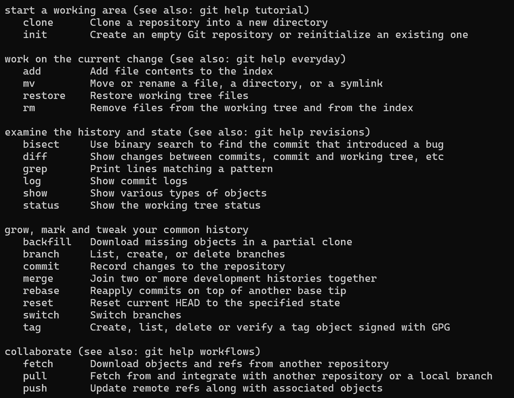
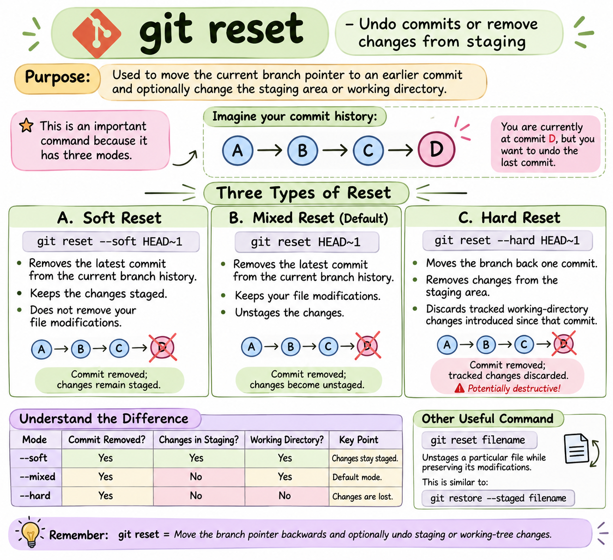
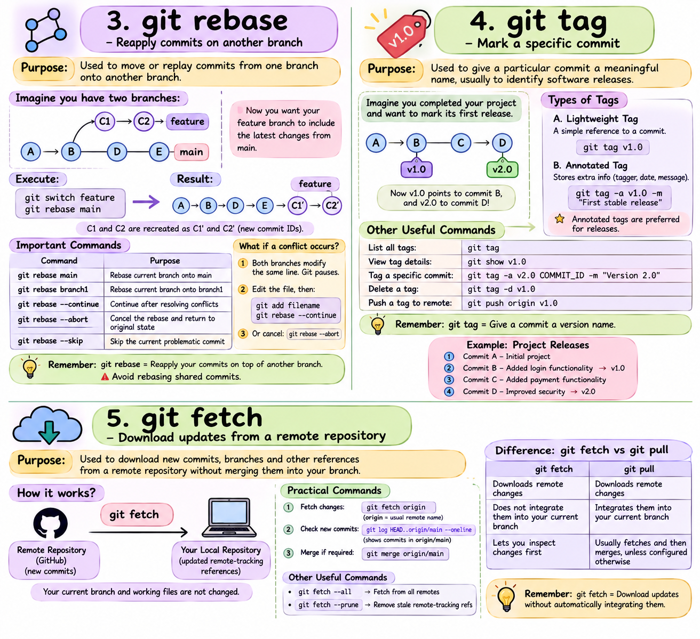

# GIT

git commands:

`git` → shows the version and stuffs

`git status` → in the folder, it shows the status of the folder, and tracked and untracked info of the files

`git clone *origin_location .git*`

`git add .` → adds everything

`git add [x.py](http://x.py)` → adds x.py to the local file

`git commit -m “adding the new file 2.py”` → commits the desired file to the local git folder. (not into the GitHub repo) 

here, -m denotes the message 

“xxx” → compulsory metadata of the file

- example → added the file, udmated modified, deleted etc…

`git push origin main` → pushes the changes into the repo’s main branch

- from the storing foler to the repo
- origin means that repo location code
- main is the location to push. not the branch ig

`git pull` → to pull the added code from the github to your local file. In a team project, if a person modifies the repo, you can just pull the modified version

local file TO GitHub

Just like usual,

`git init` → creates an empty git folder 

`git add .` → adds every files to the local git folder 

`git commit -m “xxx”` → metadata

`git remote add origin xxxxx.git` → map the repo to the local file

`git branch` → allows you to see the branches in the local repo

`git branch -M main` → allows you to change the main brach name “Master” to “main” 

now,

`git push origin main` → pushes to git files to the repo

## Branching

`git branch -a` → to view all the branches in the repo

`git checkout branch1` → to change the branch

now to add the file, blah blah normal

`git push origin branch1`   → pushing the file/s to the created branch1

`git diff branch1`   → to file the difference in main and branchx

## Merging

currently at the main branch (`git checkout main`)

`git merge branch1` → merge current branch to branch1 → (files will store at main here)

`git pull` → updates to the hub

## Pull Request

completely done in gitHub, not locally(for the example)

### MergeConflict

- happens when same file is pull requested but both got different codes
- can be resolved by the repo owner

## Additional Informations

- `git pull origin main` → when in another branch x, the code from main can be updated to the local file of branch x dealer. (can be useful for group projects when working on the same file and project folder)



rm

- `git rm filename.txt` → removes the file after the file is commited
- `git rm -f [filename.t](http://filename.tt)xt` → removes the file forcefully no matter what

mv

- `git mv oldfilename.txt newfilename.txt` → old to new , stages the change
- `git mv text.txt doc/text.txt` moves the text.txt file into doc/ directory likewise                     `git mv doc/text.txt text.txt` doc to main folder
- Undoing the naming


restore 

- `git restore remove.txt`  → restores from the staging area. the untracked modifications are gone.
- `git restore --staged remove.txt` → restores the last commited chages to the staged area. the untracked files are not changed
- `git restore --source=HEAD --staged --worktree remove.txt` → restores the deleted file from the last commited one
    - HEAD → latest commit
    - HEAD~1 → 1 commit before HEAD
    - HEAD~2→ 2 commit before HEAD

bisect

- Using binary search, it allows to bisect each commit and displays the bad commit stage with your input good/bad
- `git bisect start`
- `git bisect good` ; `git bisect bad`
- `git bisect reset` → finishes and goes to the working area

grep

- searches for the word/text in files

> PS F:\subha\gitclass> `git grep "hi"`                                                                                        text.txt:hi
[text2.py](http://text2.py/):#hi
> 

> PS F:\subha\gitclass> `git grep -n "hi"`                                                                                         text.txt:1:hi
[text2.py:1](http://text2.py:1/):#hi
> 

> PS F:\subha\gitclass> `git grep 'hi'`                                                                    [text2.pytext2.py](http://text2.py/):#hi
> 

log

`git log` → Complete commit history

`git log --oneline` →Short commit history

`git log -5` →Latest 5 commits

`git log --graph` → Visual commit history

`git log --oneline --all --graph` → Compact graph of all branches

show

info about a particular commit 

`git show 017a0a9`

<aside>


commit 017a0a91886a83a349e22544d3fcee86a45ad64e
Author: Subhasri [subhasri1476@gmail.com](mailto:subhasri1476@gmail.com)
Date:   Sat Nov 14 07:20:32 2026 +0530

```
adding throught init
```

diff --git a/text.txt b/text.txt
new file mode 100644
index 0000000..32f95c0
--- /dev/null
+++ b/text.txt
@@ -0,0 +1 @@
+hi
\ No newline at end of file
PS F:\subha\gitclass>

</aside>

switch

- same as checkout but an individual command just for switching
- `git switch branch3` → switch to branch3
- `git switch -c branch4`  → create a branch and then switch
- checkout does multiple work in the older version of git, i.e., branch switching (`git checkout branch3`) , branch creation (-b) and restore files (`--`)

reset



rebase, tag, fetch



okay git basic is done !! 

November 14, 2026